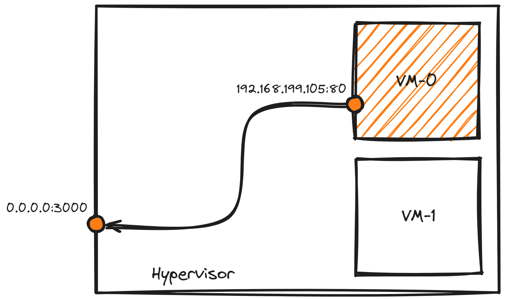

# Documentation

**fwdctl** has many commands to manage your forwards. Let's dive into them!

### Apply

The `apply` command is used to apply rules from a rules file. Here's a rules file example.

```shell
cat << EOF > rules.yml
rules:
  - dport: 2022
    saddr: 192.168.122.43
    sport: 22
    iface: eth1
    proto: tcp
  - dport: 3022
    saddr: 192.168.122.44
    sport: 22
    iface: eth1
    proto: tcp
EOF
```

Once created, you can easily run:

```shell
sudo fwdctl apply --file rules.yml
```

and apply all the rules listed in the file.

#### Hooks

Each rule can define optional **hooks**: commands executed after the
corresponding forward is created or deleted. This is useful to run side
effects such as notifying a service, updating DNS, or logging.

```yaml
rules:
  - dport: 2022
    saddr: 192.168.122.43
    sport: 22
    iface: eth1
    proto: tcp
    hooks:
      on-create: "/path/to/on-create-script.sh --port 2022"
      on-delete: "/path/to/on-delete-script.sh --port 2022"
```

Details:

* A hook command is run through `sh -c`, so it can include arguments,
  pipes and shell expansion.
* The `on-create` hook runs **after** the forward is applied; the
  `on-delete` hook runs **after** the forward is removed. A hook never
  prevents the forward change itself.
* By default, if a hook exits non-zero the program exits non-zero as well
  (for `apply`/`delete`, on the first failing hook). Pass
  `--continue-on-hook-fail` to log the failure and keep going instead.
* Hooks are only available where the rules file provides context:
  `fwdctl apply`, `fwdctl delete --file`, and the `daemon`. They are **not**
  run by `fwdctl create`, `fwdctl delete --id`, or `fwdctl delete --all`,
  since those paths have no access to a rule's hooks.
* In `daemon` mode the `on-create` hook fires when a rule is applied at
  startup or added via a config change, and the `on-delete` hook fires when
  a rule is removed via a config change or during shutdown. Without
  `--continue-on-hook-fail`, a failing hook makes the daemon tear down its
  forwards and exit non-zero.

### Create

The `create` command is used to create single rules manually. Let's see an example.



To implement the rule for this scenario, just type the following command:

```shell
sudo fwdctl create --destination-port 3000 --source-address 192.168.199.105 --source-port 80
```

### Daemon

The `daemon` command is used to run `fwdctl` as service.

When modifications are applied to the rules file, `fwdctl` is triggered and start to apply changes that have been requested.

To start the daemon, run the following command:

```shell
sudo fwdctl daemon start -f rules.yaml
```

When you want to stop the daemon execution, then type:

```shell
sudo fwdctl daemon stop
```

This will remove all the forwards that have been applied during its execution.

Here's a demo on how to use this command:

[](https://asciinema.org/a/553296)

### Delete

The `delete` command is used to delete rules using their ID or a file where the rules are listed.

To delete a specific rule (identified with a number), type the following command:

```shell
sudo fwdctl delete --id 4
```

This will remove the rule n. **4**, listed from **iptables**.

To delete a set of rules listed in a *rule file*, type the following command:

```shell
sudo fwdctl delete --file rules.yaml
```

This will remove the listed rules within the file.

### List

The `list` command is used to list the applied rules.

To list the rules, type the following command:

```shell
sudo fwdctl list
```

The output will look like this:

```shell
+--------+-----------+----------+---------------+----------------+---------------+
| NUMBER | INTERFACE | PROTOCOL | EXTERNAL PORT |  INTERNAL IP   | INTERNAL PORT |
+--------+-----------+----------+---------------+----------------+---------------+
|      1 | lo        | tcp      |          2022 | 192.168.122.43 |            22 |
|      2 | lo        | tcp      |          3022 | 192.168.122.44 |           443 |
+--------+-----------+----------+---------------+----------------+---------------+
```

If you want to use a different view of applied rules, you can choose between different format:

```shell
sudo fwdctl list --output json
```

### Generate

The `generate` command is used to generate the following files:

* **systemd** service for `fwdctl`
* rules empty file

To generate a systemd service, type the following command:

```shell
fwdctl generate systemd -o fwdctl.service
```

To generate a `fwdctl` rules file, instead, type the following command:

```shell
fwdctl generate rules -o rules.yml
```

### Version

The `version` command is used show the version of the program.
